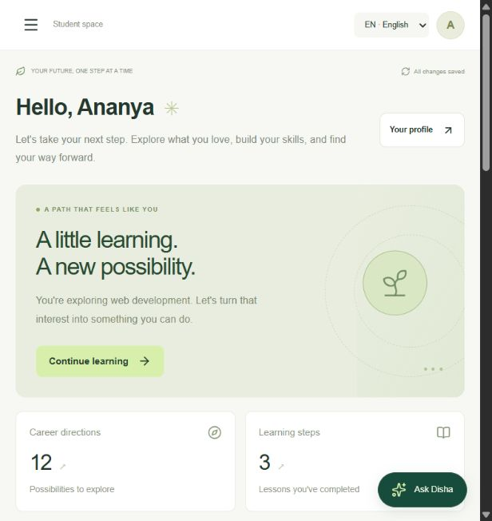

# Disha

A rural learning-to-livelihood PWA for the Citi challenge. Built with the supplied Vinext/Cloudflare starter and established open-source libraries. Kolibri is the main product reference; Disha is not a Kolibri fork. See THIRD_PARTY_NOTICES.md for actual reuse.

**Submission:** [solution and five-minute demo](SUBMISSION.md) · [architecture](ARCHITECTURE.md) · [verification](VERIFICATION.md) · [API reference](public/openapi.json) · [research](docs/EXISTING_SOLUTIONS_RESEARCH.md).

## Implemented

- Twelve explainable career pathways, eight original courses, sixteen lessons/assessments, career trials and a learning passport with JSON export/printing.
- English, Hindi and Marathi navigation, common screens/forms and all sixteen bundled lessons. Provider text, user-authored content, career descriptions and some dynamic errors/statuses retain their source language. Browser speech includes typed alternatives.
- D1 persistence, IndexedDB outbox, revision conflicts, replay protection and prepared offline shell.
- Independent owner, teacher, student, mentor and employer accounts. Email-bound invitations expire after 48 hours, are single-use and revocable. Server authorization scopes linked learners to their records; facilitator notes remain private.
- Centre selection, learner management, assignments, notes, module authoring and employer opportunity publishing.
- Consented applications to onboarded employers inside the centre, durable receipts, review decisions and withdrawal. External provider applications still happen on their websites; their checklists are self-reported.
- Onboarded mentor availability, session proposals, overlap protection, confirmation/cancellation/completion and participant conversations.
- Source-linked guidance using optional Cloudflare Workers AI or Ollama adapters and a clearly labelled retrieval fallback.
- Provider JSON import/refresh with provenance and freshness dates. Source reachability is distinct from verification of eligibility/vacancies. Nine official source/directory entries and two labelled demonstrations were bundled on 2026-10-17.
- Razorpay hosted payment links, one-time module access, 30-day centre passes, optional monthly subscriptions, provider reconciliation, signed webhooks and server-enforced entitlements. Checkout is disabled without credentials.
- Durable rate limits, audit records, bounded input and same-origin JSON writes. API reference: public/openapi.json.
- Owner pilot board with eleven evidence-backed acceptance checks, configuration-presence indicators, joined-account counts and JSON report download. Test outcomes are explicitly self-reported.
- One-time purchase refund reconciliation, capture verification and payment-time-based expiry. Refunded receipts cannot regain access through stale paid-event replay.

## Local setup

Requires Node 22.13+ (Node 24 supported), npm and Git. No Cloudflare account is needed for local D1 emulation.

    npm ci
    npm run db:migrate
    npm run dev

Open `http://127.0.0.1:5173` and choose **Sign in with ChatGPT**. Local development supplies a test identity; no provider credentials or Cloudflare account are required. Two labelled sample learners are created in a new owner workspace. AI uses labelled retrieval unless a model provider is configured, and payments remain disabled until merchant credentials are configured.

`db:migrate` is local-only and safe to repeat. It recognizes existing schemas created by the earlier manual instructions, preserves their application records, and records applied migrations. An unknown schema stops migration for inspection. Hosted Sites deployments continue to apply their own versioned migrations. Development sign-in is loopback-only and excluded from hosted builds.

If the Windows npm shim fails, invoke the real entrypoint:

    & 'C:\Program Files\nodejs\node.exe' 'C:\Program Files\nodejs\node_modules\npm\bin\npm-cli.js' run dev

## Verification

    npm run verify

This runs TypeScript checks, unit/security tests, the production build, offline asset generation and separate-account HTTP checks against the **local compiled Worker**. It initializes an isolated database, verifies repeat migration, selects a free loopback port and stops its test server automatically. It uses no provider credentials and does not change your development database. GitHub Actions runs the same command on pushes and pull requests.

Individual checks are also available:

    npm run typecheck
    npm test
    npm run build
    npm run test:integration

Integration tests create disposable `.test` identities locally. Never target hosted Sites with simulated identity headers. `npm run test:api` checks original profile/sync and local sign-in safeguards against a running development server on port 5173. See VERIFICATION.md for release evidence.

## Pilot activation

The existing [Disha site](https://disha-learning-pathways.buzzyrook128.chatgpt.site/) retains its owner-only audience. Centre membership does not bypass the Sites sign-in gate. The owner must grant intended pilot users site access separately, then use Community & accounts → Team for centre invitations. Learners/mentors link to existing profiles; teachers/employers do not need profile links.

INTEGRATIONS.md documents AI, payments and feeds. Real credentials, consenting mentors/employers and physical device tests remain external dependencies. No live transaction has been tested or charged. This is a functional hackathon implementation; production commerce operations and field validation remain pilot work.
